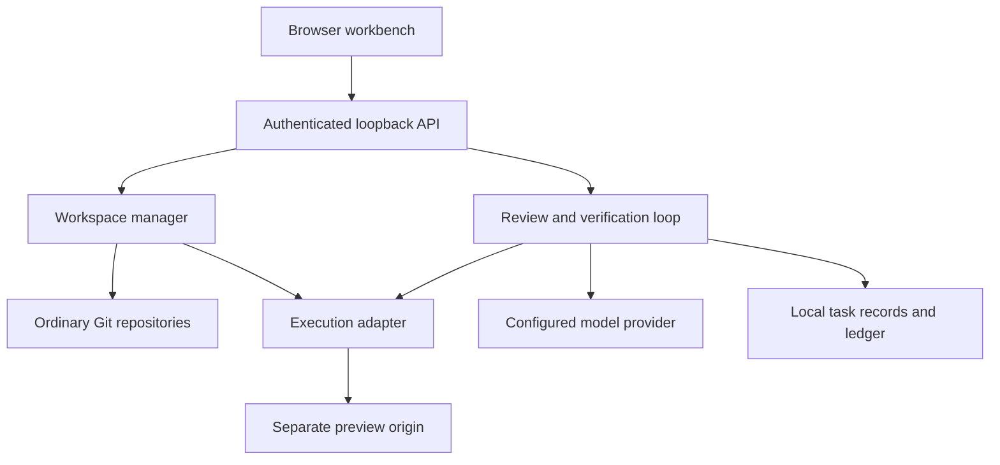

# CommCode

**Software creation that people can own.**

CommCode is an independently implemented, open-source workbench for creating,
editing, running and understanding software. Source projects remain ordinary Git
repositories. The platform is licensed under AGPL-3.0-or-later; the included
starter templates are CC0-1.0. There is no paid feature gate, telemetry or mandatory
AI subscription.

**Development snapshot: 0.1.0-dev.1.** Public repository:
[Albertito-AI/CommCode](https://github.com/Albertito-AI/CommCode). This is a
single-operator local development release candidate, not a production cloud IDE. Read the [verification record](docs/VERIFICATION.md)
for what was actually tested. A repository URL, release tag or workflow file is
not evidence of publication or a successful CI run.

## What works in the tested local path

- Token-authenticated loopback API, project creation and durable local metadata.
- A browser interface with a bundled CodeMirror editor, file explorer and
  optimistic concurrency checks. Browser rendering verification remains pending.
- JavaScript expense tracker and Python API starters with real tests.
- Bounded command execution with output limits, timeouts and cancellation.
- Application startup and HTTP readiness checks, with a separate preview origin.
- Git status, diff, secret-pattern checks, commits and Git bundle export.
- Source-context review, structured AI proposals, review before application,
  configured tests, bounded repair, conflict-aware rollback and an activity ledger.
  AI orchestration was tested using clearly labelled deterministic fixtures.
- Ollama and OpenAI-compatible protocol adapters tested against local HTTP fixtures.
  Live inference requires an operator-configured model and remains unverified here.

## Implemented but awaiting environment verification

Docker execution is the default and never silently falls back to host execution.
The adapter applies resource limits, non-root execution, read-only root filesystems,
read-only Git internals and temporary network access for dependency installation.
The dedicated Docker integration suite has not run in the authoring environment,
which has no Docker engine. The supplied CI requires this suite.

Public GitHub import was verified against an existing public repository. Repository
creation and push adapters are implemented.
Authenticated create/push requires a user-supplied token. No live authenticated
GitHub write or public deployment was performed while preparing this snapshot.

## Quick start

Prerequisites: Linux, Node.js 24+, Git and Docker Engine. Run as an unprivileged user.

```sh
npm ci
npm run build
npm run setup:runtime
npm start
```

Open `http://127.0.0.1:4317`. Read the access-token file whose path the server prints,
then paste its contents into the sign-in form. The token is not printed in logs.
Create an expense tracker, open a file, save a change, run tests and start preview.
Stop the application before making further edits. Inspect the diff and commit.

For trusted starter projects on a machine without Docker only:

```sh
npm start -- --unsafe-local
```

This explicitly runs commands on the host **without isolation**. It is a testing
and development option, not a sandbox. Never use it for untrusted repositories.

No AI is needed for the editor, tests, Git or previews. To enable a local model,
see the [provider guide](docs/AI_PROVIDERS.md). Review source context before sending
it to any provider. External model usage may incur charges from that provider.

## Verification

```sh
npm run verify
npm run format:check
npm audit
npm run demo
# Requires a Docker engine and the locally built runtime image:
npm run test:docker
```

The demo executes real starter tests, makes a real edit, starts an HTTP application,
inspects the diff and creates a local commit. It does not claim to use an AI model.
The repair integration tests deliberately inject a bad implementation as a labelled
fault-injection fixture. Those failures are not presented as spontaneous model errors.

## Current limits

The console is not a full PTY terminal. There is no OAuth, multi-user tenancy,
production deployment service, collaborative editing, Kubernetes, microVM isolation,
native Anthropic/Gemini adapter, billing guarantee or automatic vulnerability repair.
Previews currently support GET/HEAD, relative asset URLs and a fixed internal port.
They do not support WebSockets, redirects, root-relative asset rewriting or POST.
The expense starter stores data in memory, with a JSON export button.

Git export includes committed history only. AI operations require a clean Git
working tree. Inspection is bounded to 500 files; model context is at most 30 files
and 48,000 characters. Secret detection is heuristic and cannot guarantee detection.
An authenticated operator can execute code. **Do not expose this development server
publicly or use it as a boundary between mutually untrusted users.**

## Architecture



Read [architecture](ARCHITECTURE.md), [threat model](THREAT_MODEL.md),
[installation](docs/INSTALLATION.md), [self-hosting](docs/SELF_HOSTING.md),
[developer guide](docs/DEVELOPMENT.md), [deployment](docs/DEPLOYMENT.md),
[troubleshooting](docs/TROUBLESHOOTING.md) and the [roadmap](ROADMAP.md).

## Public-interest commitment

Users can inspect, modify, run and fork CommCode. Its core remains useful without
payment. Institutions may run their own copies, and users may leave with their
source and history. Funding, if introduced, serves maintenance and access rather
than deliberate feature restrictions. Important architectural decisions are recorded
in [ADRs](docs/adr/). See [governance](GOVERNANCE.md) and [contributing](CONTRIBUTING.md).

CommCode is the owner's selected project name. An existing software business uses
commcode.com; no claim of trademark clearance or affiliation is made. See
[naming research](docs/NAMING.md). No domain has been purchased.
